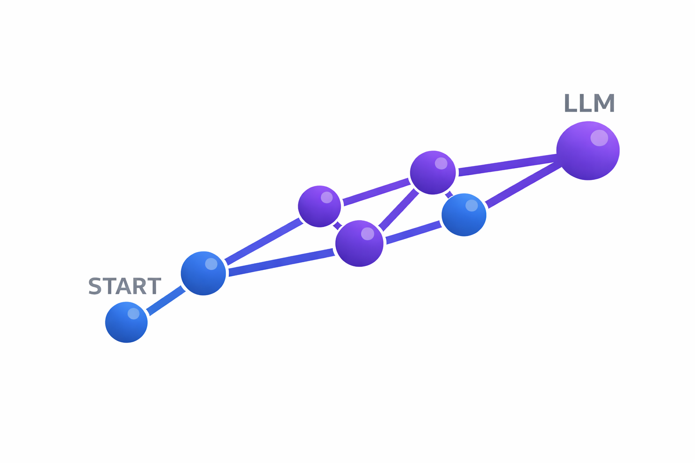

<div align="center">



# AI Engineering: From Foundations to Production Agents

### Master AI, LLMs, Agents & Modern Frameworks

**Open-source AI engineering curriculum for building intelligent systems.**

From ML Fundamentals → LLMs & RAG → AI Agents → Production Deployment

[**Get Started**](#quick-start) • [Curriculum](./documentation/CURRICULUM.md) • [Live Demos](https://nexageapps.github.io/AI/) • [Student Guide](./documentation/STUDENT_GUIDE.md)

[](https://www.python.org/)
[](./LICENSE)
[](./documentation/CURRICULUM.md)
[](https://github.com/nexageapps/AI/stargazers)

</div>

---

## Learning Journey

```
╔══════════════════════════════════════════════════════════════════════════╗
║                       AI ENGINEERING CURRICULUM                          ║
║                          177 Lessons • 579 Hours                         ║
╠══════════════════════════════════════════════════════════════════════════╣
║                                                                          ║
║  LAYER 1: FOUNDATIONS                              [18 lessons • 48h]   ║
║  ┌────────────────────────────────────────────────────────────────────┐ ║
║  │ Basic Machine Learning                                             │ ║
║  │ • Linear Regression        • Classification    • Neural Networks   │ ║
║  │ • Gradient Descent         • Backpropagation   • CNNs              │ ║
║  │ • Loss Functions           • Optimization      • Transformers      │ ║
║  └────────────────────────────────────────────────────────────────────┘ ║
║                                 │                                        ║
║                                 ▼                                        ║
║  LAYER 2: DEEP LEARNING                            [26 lessons • 78h]   ║
║  ┌────────────────────────────────────────────────────────────────────┐ ║
║  │ Intermediate Architectures                                         │ ║
║  │ • Computer Vision          • Object Detection   • Segmentation     │ ║
║  │ • NLP & Embeddings         • Sequence Models    • Attention        │ ║
║  │ • Transfer Learning        • Fine-tuning        • Evaluation       │ ║
║  └────────────────────────────────────────────────────────────────────┘ ║
║                                 │                                        ║
║                                 ▼                                        ║
║  LAYER 3: LLM ENGINEERING                          [15 lessons • 48h]   ║
║  ┌────────────────────────────────────────────────────────────────────┐ ║
║  │ Advanced Language Models                                           │ ║
║  │ • Fine-tuning LLMs         • RAG Systems        • Vector DBs       │ ║
║  │ • Prompt Engineering       • Context Windows    • Embeddings       │ ║
║  │ • Model Evaluation         • Safety & Bias      • Optimization     │ ║
║  └────────────────────────────────────────────────────────────────────┘ ║
║                                 │                                        ║
║                    ┌────────────┴────────────┐                          ║
║                    ▼                         ▼                          ║
║  LAYER 4A: AI AGENTS              LAYER 4B: PRODUCTION FRAMEWORKS       ║
║  [18 lessons • 56h]                [35 lessons • 140h]                  ║
║  ┌──────────────────────────┐     ┌──────────────────────────┐         ║
║  │ Autonomous Systems       │     │ Modern AI Stack          │         ║
║  │ • LangChain Basics       │     │ • LlamaIndex             │         ║
║  │ • LangGraph Workflows    │     │ • DSPy                   │         ║
║  │ • Memory & State         │     │ • Haystack               │         ║
║  │ • Tool Use               │     │ • Vector Databases       │         ║
║  │ • Multi-Agent Systems    │     │ • FastAPI & Deployment   │         ║
║  │ • Production Deployment  │     │ • Monitoring & Ops       │         ║
║  └──────────────────────────┘     └──────────────────────────┘         ║
║                    │                         │                          ║
║                    └────────────┬────────────┘                          ║
║                                 ▼                                        ║
║  LAYER 5: RESEARCH FRONTIERS                       [26 lessons • 92h]   ║
║  ┌────────────────────────────────────────────────────────────────────┐ ║
║  │ Expert Topics                                                      │ ║
║  │ • Latest Research          • Model Alignment    • Interpretability │ ║
║  │ • RLHF & Training          • Multimodal AI      • Efficiency       │ ║
║  │ • Custom Architectures     • Paper Implementation                  │ ║
║  └────────────────────────────────────────────────────────────────────┘ ║
║                                                                          ║
║  ELECTIVES: Specialized Topics                     [39 lessons • 117h]  ║
║  ┌────────────────────────────────────────────────────────────────────┐ ║
║  │ Classical AI • Domain-Specific Applications • Legacy Frameworks    │ ║
║  └────────────────────────────────────────────────────────────────────┘ ║
╚══════════════════════════════════════════════════════════════════════════╝
```

---

## Quick Start

```bash
# Clone the repository
git clone https://github.com/nexageapps/AI.git && cd AI

# Setup virtual environment
python -m venv .venv
source .venv/bin/activate          # Windows: .venv\Scripts\activate

# Install dependencies
pip install -r requirements.txt

# Launch Jupyter
jupyter lab
```

**For live agent lessons:** Set `ANTHROPIC_API_KEY` environment variable. Without it, lessons replay recorded traces so you can still learn for free.

---

## Learning Paths

```
═══════════════════════════════════════════════════════════════════════════
PATH 1: COMPLETE JOURNEY                                      [579 hours]
═══════════════════════════════════════════════════════════════════════════

START
  │
  ├──► BASIC (6 weeks)
  │    ├─ Linear Regression & Neural Networks
  │    ├─ CNNs & Computer Vision Basics  
  │    └─ Transformers Introduction
  │
  ├──► INTERMEDIATE (9 weeks)
  │    ├─ Advanced Computer Vision
  │    ├─ NLP & Text Processing
  │    └─ Sequence Models & Attention
  │
  ├──► ADVANCED (5 weeks)
  │    ├─ LLM Fine-tuning
  │    ├─ RAG Systems
  │    └─ Prompt Engineering
  │
  ├──► AGENTS (6 weeks)
  │    ├─ LangChain Fundamentals
  │    ├─ LangGraph Workflows
  │    └─ Production Agent Systems
  │
  ├──► APPLIED (12 weeks)
  │    ├─ LlamaIndex & DSPy
  │    ├─ Vector Databases
  │    └─ FastAPI Deployment
  │
  └──► EXPERT (9 weeks)
       └─ Research Frontiers & Cutting Edge
END (47 weeks total)

═══════════════════════════════════════════════════════════════════════════
PATH 2: FAST TRACK TO AGENTS                                  [110 hours]
═══════════════════════════════════════════════════════════════════════════

START (You know ML fundamentals)
  │
  ├──► ADVANCED: A01-A04 (2 weeks)
  │    └─ LLM Fundamentals & RAG
  │
  ├──► AGENTS: AG01-AG18 (6 weeks)
  │    └─ Complete Agent Development
  │
  └──► APPLIED: AP01-AP10 (4 weeks)
       └─ Production Skills
END (12 weeks total)

═══════════════════════════════════════════════════════════════════════════
PATH 3: LLM DEVELOPER TO PRODUCTION                            [90 hours]
═══════════════════════════════════════════════════════════════════════════

START (You know LLM APIs)
  │
  ├──► AGENTS: AG02-AG18 (5 weeks)
  │    └─ Agent Systems & Workflows
  │
  └──► APPLIED: AP01-AP35 (7 weeks)
       └─ Production Frameworks
END (12 weeks total)

═══════════════════════════════════════════════════════════════════════════
PATH 4: RESEARCH TRACK                                        [150 hours]
═══════════════════════════════════════════════════════════════════════════

START
  │
  ├──► BASIC: Skim (2 weeks)
  │
  ├──► INTERMEDIATE (9 weeks)
  │
  ├──► ADVANCED: A05-A07 (2 weeks)
  │
  └──► EXPERT (9 weeks)
END (22 weeks total)
```

---

## Technology Stack

```
╔══════════════════════════════════════════════════════════════════════════╗
║                          COMPLETE TECH STACK                             ║
╠═══════════════════════╦═══════════════════════╦══════════════════════════╣
║                       ║                       ║                          ║
║   FOUNDATIONS         ║   AI AGENTS           ║   PRODUCTION             ║
║                       ║                       ║                          ║
║   • PyTorch           ║   • LangChain         ║   • FastAPI              ║
║   • TensorFlow        ║   • LangGraph         ║   • Docker               ║
║   • scikit-learn      ║   • LlamaIndex        ║   • Kubernetes           ║
║   • NumPy/Pandas      ║   • DSPy              ║   • GitHub Actions       ║
║   • Transformers      ║   • CrewAI            ║   • Prometheus           ║
║   • Jupyter           ║   • Semantic Kernel   ║   • Grafana              ║
║                       ║   • Haystack          ║   • Redis                ║
║                       ║                       ║   • PostgreSQL           ║
║                       ║                       ║                          ║
╠═══════════════════════╬═══════════════════════╬══════════════════════════╣
║                       ║                       ║                          ║
║   VECTOR STORES       ║   LLM PROVIDERS       ║   FRAMEWORKS             ║
║                       ║                       ║                          ║
║   • Pinecone          ║   • OpenAI GPT-4      ║   • Guardrails AI        ║
║   • Weaviate          ║   • Anthropic Claude  ║   • LangSmith            ║
║   • Qdrant            ║   • Google Gemini     ║   • LangFuse             ║
║   • Chroma            ║   • Cohere            ║   • Weights & Biases     ║
║   • FAISS             ║   • Open-source LLMs  ║   • MLflow               ║
║                       ║                       ║                          ║
╚═══════════════════════╩═══════════════════════╩══════════════════════════╝
```

---

## Curriculum Status

```
╔══════════════════════════════════════════════════════════════════════════╗
║                          MODULE COMPLETION                               ║
╠════════════════════╦════════╦═══════╦══════════════════════════════════╣
║ Module             ║ Lessons║ Hours ║ Progress                         ║
╠════════════════════╬════════╬═══════╬══════════════════════════════════╣
║ Basic              ║   18   ║  48   ║ [████████████████░░] 90%         ║
║ Intermediate       ║   26   ║  78   ║ [███████████████░░░] 85%         ║
║ Advanced           ║   15   ║  48   ║ [████████████████████] 100%      ║
║ Agents             ║   18   ║  56   ║ [████████████████████] 100%      ║
║ Applied            ║   35   ║ 140   ║ [████████░░░░░░░░░░░] 40%        ║
║ Expert             ║   26   ║  92   ║ [░░░░░░░░░░░░░░░░░░░] 0%         ║
║ Electives          ║   39   ║ 117   ║ [████████████████████] 100%      ║
╠════════════════════╬════════╬═══════╬══════════════════════════════════╣
║ TOTAL              ║  177   ║ 579   ║ [████████████░░░░░░░] 62%        ║
╚════════════════════╩════════╩═══════╩══════════════════════════════════╝
```

### Module Breakdown

| Tier | Focus | Key Topics | Status | Folder |
|------|-------|------------|--------|--------|
| **Basic** | ML Fundamentals | Regression, Neural Networks, CNNs, Transformers | 90% Complete | [`Basic/`](./Basic) |
| **Intermediate** | Deep Learning | Computer Vision, NLP, Sequence Models, GANs | 85% Complete | [`Intermediate/`](./Intermediate) |
| **Advanced** | LLM Engineering | Fine-tuning, RAG, Prompt Engineering, Evaluation | 100% Complete | [`Advanced/`](./Advanced) |
| **Agents** | AI Agent Systems | LangChain, LangGraph, Tools, Memory, Multi-agent | 100% Complete | [`Agents/`](./Agents) |
| **Applied** | Production | LlamaIndex, DSPy, Vector DBs, FastAPI, Deployment | 40% Complete | [`Applied/`](./Applied) |
| **Expert** | Research | Frontier models, RLHF, Alignment, Interpretability | Planned | [`Expert/`](./Expert) |
| **Electives** | Specialized | Classical AI, Domain-specific applications | 100% Available | [`Electives/`](./Electives) |

---

## Interactive Demonstrations

**Explore AI concepts visually** → [**Launch All Demos**](https://nexageapps.github.io/AI/)

```
╔══════════════════════════════════════════════════════════════════════════╗
║                        INTERACTIVE LEARNING TOOLS                        ║
╠══════════════════════════════════════════════════════════════════════════╣
║                                                                          ║
║  [1] SYMBOLIC AI & LOGIC                                                ║
║  ┌────────────────────────────────────────────────────────────────────┐ ║
║  │ • Wumpus World                   Logic & Knowledge Representation  │ ║
║  │   → Learn: Symbolic reasoning, uncertainty, planning               │ ║
║  └────────────────────────────────────────────────────────────────────┘ ║
║                                                                          ║
║  [2] OPTIMIZATION & TRAINING                                            ║
║  ┌────────────────────────────────────────────────────────────────────┐ ║
║  │ • Mountain Explorer               Gradient Descent Visualization   │ ║
║  │   → Learn: Optimization, learning rates, convergence               │ ║
║  │                                                                     │ ║
║  │ • Blindfold Hill                  Learning Rate Tuning             │ ║
║  │   → Learn: Hyperparameter effects, local minima                    │ ║
║  └────────────────────────────────────────────────────────────────────┘ ║
║                                                                          ║
║  [3] NEURAL NETWORKS                                                    ║
║  ┌────────────────────────────────────────────────────────────────────┐ ║
║  │ • Neural Network Trainer          Forward & Backward Propagation   │ ║
║  │   → Learn: Backprop, activations, weight updates                   │ ║
║  │                                                                     │ ║
║  │ • CNN Explorer                    Convolutional Neural Networks    │ ║
║  │   → Learn: Convolution, pooling, feature maps                      │ ║
║  │                                                                     │ ║
║  │ • Data Preprocessing Studio       Feature Engineering              │ ║
║  │   → Learn: Scaling, encoding, missing values                       │ ║
║  └────────────────────────────────────────────────────────────────────┘ ║
║                                                                          ║
║  [4] LANGUAGE MODELS                                                    ║
║  ┌────────────────────────────────────────────────────────────────────┐ ║
║  │ • Knowledge Graph Playground      RDF & Semantic Search            │ ║
║  │   → Learn: Triples, knowledge graphs, RAG                          │ ║
║  │                                                                     │ ║
║  │ • RNN Explorer                    Sequence Modeling                │ ║
║  │   → Learn: RNN, LSTM, GRU, gates                                   │ ║
║  │                                                                     │ ║
║  │ • Transformer Explorer            Self-Attention Mechanism         │ ║
║  │   → Learn: Q/K/V matrices, multi-head attention                    │ ║
║  │                                                                     │ ║
║  │ • BPE Explorer                    Tokenization                     │ ║
║  │   → Learn: Byte pair encoding, subwords                            │ ║
║  └────────────────────────────────────────────────────────────────────┘ ║
║                                                                          ║
╚══════════════════════════════════════════════════════════════════════════╝
```

### Featured Demonstrations

<table>
<tr>
<td width="33%" align="center">
<h4>Wumpus World</h4>

<p><strong>Symbolic Logic & Reasoning</strong></p>
<p>Knowledge representation, uncertainty</p>
<p><a href="https://nexageapps.github.io/AI/wumpus">► Launch Demo</a></p>
</td>
<td width="33%" align="center">
<h4>Gradient Descent</h4>

<p><strong>Optimization Fundamentals</strong></p>
<p>Learning rates, convergence</p>
<p><a href="https://nexageapps.github.io/AI/gradient-descent">► Launch Demo</a></p>
</td>
<td width="33%" align="center">
<h4>CNN Explorer</h4>

<p><strong>Convolutional Networks</strong></p>
<p>Feature maps, pooling, filters</p>
<p><a href="https://nexageapps.github.io/AI/neural-networks/week3/cnn-explorer/">► Launch Demo</a></p>
</td>
</tr>
<tr>
<td width="33%" align="center">
<h4>Knowledge Graphs</h4>

<p><strong>Semantic Reasoning</strong></p>
<p>RDF triples, graph queries</p>
<p><a href="https://nexageapps.github.io/AI/ai-fundamentals/week3/kg-playground/">► Launch Demo</a></p>
</td>
<td width="33%" align="center">
<h4>Transformer</h4>

<p><strong>Self-Attention</strong></p>
<p>Q/K/V matrices, multi-head attention</p>
<p><a href="https://nexageapps.github.io/AI/neural-networks/week4/transformer-explorer/">► Launch Demo</a></p>
</td>
<td width="33%" align="center">
<h4>BPE Tokenization</h4>

<p><strong>Subword Encoding</strong></p>
<p>Byte pair encoding, vocabulary</p>
<p><a href="https://nexageapps.github.io/AI/neural-networks/week4/bpe-explorer/">► Launch Demo</a></p>
</td>
</tr>
</table>

[**View All 14+ Demonstrations →**](https://nexageapps.github.io/AI/)

---

## Why This Curriculum

```
╔══════════════════════════════════════════════════════════════════════════╗
║                        LESSON DESIGN PATTERN                             ║
╠══════════════════════════════════════════════════════════════════════════╣
║                                                                          ║
║  [STEP 1] REAL-WORLD SCENARIO                                           ║
║  ┌────────────────────────────────────────────────────────────────────┐ ║
║  │ "You're building a customer service chatbot that needs to           │ ║
║  │  remember conversation context across multiple interactions..."     │ ║
║  └────────────────────────────────────────────────────────────────────┘ ║
║                                  │                                       ║
║                                  ▼                                       ║
║  [STEP 2] LEARNING OBJECTIVES                                           ║
║  ┌────────────────────────────────────────────────────────────────────┐ ║
║  │ ✓ Understand context windows and token limits                       │ ║
║  │ ✓ Implement conversation memory systems                             │ ║
║  │ ✓ Use vector stores for long-term memory                            │ ║
║  │ ✓ Handle context overflow gracefully                                │ ║
║  └────────────────────────────────────────────────────────────────────┘ ║
║                                  │                                       ║
║                                  ▼                                       ║
║  [STEP 3] CONCEPT EXPLANATION                                           ║
║  ┌────────────────────────────────────────────────────────────────────┐ ║
║  │ Theory → Visualizations → Mathematical Foundations → Examples       │ ║
║  └────────────────────────────────────────────────────────────────────┘ ║
║                                  │                                       ║
║                                  ▼                                       ║
║  [STEP 4] BUILD FROM SCRATCH                                            ║
║  ┌────────────────────────────────────────────────────────────────────┐ ║
║  │ class ConversationMemory:                                           │ ║
║  │     def __init__(self, max_tokens=2000):                            │ ║
║  │         self.history = []                                           │ ║
║  │         self.max_tokens = max_tokens                                │ ║
║  │                                                                     │ ║
║  │     def add_message(self, role, content):                           │ ║
║  │         # Your implementation here                                  │ ║
║  │         pass                                                        │ ║
║  └────────────────────────────────────────────────────────────────────┘ ║
║                                  │                                       ║
║                                  ▼                                       ║
║  [STEP 5] USE PRODUCTION TOOLS                                          ║
║  ┌────────────────────────────────────────────────────────────────────┐ ║
║  │ from langchain.memory import ConversationBufferMemory              │ ║
║  │ from langchain.chains import ConversationChain                      │ ║
║  │                                                                     │ ║
║  │ memory = ConversationBufferMemory()                                 │ ║
║  │ chain = ConversationChain(llm=llm, memory=memory)                   │ ║
║  └────────────────────────────────────────────────────────────────────┘ ║
║                                  │                                       ║
║                                  ▼                                       ║
║  [STEP 6] BREAK IT & UNDERSTAND LIMITS                                  ║
║  ┌────────────────────────────────────────────────────────────────────┐ ║
║  │ What happens when:                                                  │ ║
║  │ • Conversation exceeds token limit?                                 │ ║
║  │ • Multiple users share the same session?                            │ ║
║  │ • Context needs to persist across restarts?                         │ ║
║  │ • You need semantic search over history?                            │ ║
║  └────────────────────────────────────────────────────────────────────┘ ║
║                                  │                                       ║
║                                  ▼                                       ║
║  [STEP 7] THREE-TIER EXERCISES                                          ║
║  ┌──────────────────┬──────────────────┬──────────────────────────────┐ ║
║  │ [PRACTICE]       │ [STRETCH]        │ [CHALLENGE]                  │ ║
║  │ Solidify basics  │ Apply to new     │ Push your limits             │ ║
║  │                  │ problems         │                              │ ║
║  │ • Implement      │ • Add TTL to     │ • Build hybrid memory        │ ║
║  │   basic memory   │   messages       │   system combining           │ ║
║  │ • Test with      │ • Add semantic   │   buffer + vector store      │ ║
║  │   sample conv    │   search         │ • Implement smart            │ ║
║  │                  │ • Handle errors  │   summarization              │ ║
║  └──────────────────┴──────────────────┴──────────────────────────────┘ ║
║                                  │                                       ║
║                                  ▼                                       ║
║  [STEP 8] CHECKPOINT & ASSESSMENT                                       ║
║  ┌────────────────────────────────────────────────────────────────────┐ ║
║  │ □ Can you explain how conversation memory works?                    │ ║
║  │ □ When would you choose buffer vs. vector memory?                   │ ║
║  │ □ What are the tradeoffs of each approach?                          │ ║
║  │ □ How do you handle context overflow?                               │ ║
║  └────────────────────────────────────────────────────────────────────┘ ║
║                                                                          ║
╚══════════════════════════════════════════════════════════════════════════╝

              Each lesson: 2-4 hours • Hands-on • Production-ready
```

### Core Principles

```
┌──────────────────────────────────────────────────────────────────┐
│ ✓  Runs offline, free, no GPU required                           │
│ ✓  Production-ready code examples                                │
│ ✓  Industry-standard tools and frameworks                        │
│ ✓  Hands-on exercises at every step                              │
│ ✓  Progressive difficulty curve                                  │
│ ✓  Clear, measurable learning objectives                         │
│ ✓  Self-paced with checkpoints                                   │
│ ✓  Open-source and free forever                                  │
└──────────────────────────────────────────────────────────────────┘
```

---

## Project Structure

```
AI/
│
├─── Basic/                           # 18 lessons: ML fundamentals
│    ├─ B01-tensors-and-linear-algebra.ipynb
│    ├─ B02-linear-regression.ipynb
│    ├─ B05-neural-networks.ipynb
│    ├─ B09-cnns.ipynb
│    └─ B11-transformers.ipynb
│
├─── Intermediate/                    # 26 lessons: Deep learning
│    ├─ I01-advanced-cnns.ipynb
│    ├─ I03-rnns-and-lstms.ipynb
│    ├─ I04-attention-mechanisms.ipynb
│    └─ I10-capstone.ipynb
│
├─── Advanced/                        # 15 lessons: LLMs & RAG
│    ├─ A01-fine-tuning-llms.ipynb
│    ├─ A03-rag-systems.ipynb
│    ├─ A04-prompt-engineering.ipynb
│    └─ A10-capstone.ipynb
│
├─── Agents/                          # 18 lessons: AI agents
│    ├─ AG01-intro-to-agents.ipynb
│    ├─ AG03-tools-and-function-calling.ipynb
│    ├─ AG08-langgraph-fundamentals.ipynb
│    ├─ AG11-multi-agent-systems.ipynb
│    └─ AG18-capstone.ipynb
│
├─── Applied/                         # 35 lessons: Production
│    ├─ AP01-llamaindex-intro.ipynb
│    ├─ AP07-dspy-fundamentals.ipynb
│    ├─ AP20-vector-db-production.ipynb
│    ├─ AP31-fastapi-deployment.ipynb
│    └─ AP35-capstone.ipynb
│
├─── Expert/                          # 26 lessons: Research
│    ├─ E01-rlhf-and-alignment.ipynb
│    ├─ E10-interpretability.ipynb
│    └─ E26-capstone.ipynb
│
├─── Electives/                       # 39 lessons: Specialized
│    ├─ Classical-AI/
│    ├─ Domain-Specific/
│    └─ Legacy-Frameworks/
│
├─── agentkit/                        # Shared library for agents
│    ├─ __init__.py
│    ├─ agent.py
│    ├─ tools.py
│    └─ tests/
│
├─── tools/                           # Build, test, curriculum tools
│    ├─ curriculum.json
│    ├─ nbtest.py
│    ├─ gen_readmes.py
│    └─ check_names.py
│
├─── application/                     # Interactive demos
│    ├─ ai-fundamentals/
│    ├─ neural-networks/
│    └─ README.md
│
├─── documentation/                   # All guides
│    ├─ CURRICULUM.md
│    ├─ LEARNING_SEQUENCE.md
│    ├─ LEARNING_ARCHITECTURE.md
│    ├─ QUICK_REFERENCE.md
│    └─ STUDENT_GUIDE.md
│
└─── README.md                        # This file
```

---

## Documentation

```
╔══════════════════════════════════════════════════════════════════════════╗
║                        DOCUMENTATION HUB                                 ║
╠══════════════════════════════════════════════════════════════════════════╣
║                                                                          ║
║  CORE DOCUMENTS                                                          ║
║  ┌────────────────────────────────────────────────────────────────────┐ ║
║  │ • CURRICULUM.md              Complete lesson catalog                │ ║
║  │ • LEARNING_SEQUENCE.md       Week-by-week study plans              │ ║
║  │ • LEARNING_ARCHITECTURE.md   Visual diagrams & architecture        │ ║
║  │ • QUICK_REFERENCE.md         Fast command lookup                   │ ║
║  │ • STUDENT_GUIDE.md           Study strategies & tips               │ ║
║  └────────────────────────────────────────────────────────────────────┘ ║
║                                                                          ║
║  GETTING STARTED                                                         ║
║  ┌────────────────────────────────────────────────────────────────────┐ ║
║  │ • Applied/SETUP.md           Environment setup guide               │ ║
║  │ • Applied/GETTING_STARTED    Your first agent tutorial             │ ║
║  │ • CONTRIBUTING.md            How to contribute                     │ ║
║  └────────────────────────────────────────────────────────────────────┘ ║
║                                                                          ║
║  SPECIALIZED GUIDES                                                      ║
║  ┌────────────────────────────────────────────────────────────────────┐ ║
║  │ • PROJECT_IDEAS.md           Practice projects                     │ ║
║  │ • EXAM_PREPARATION.md        Study for assessments                 │ ║
║  │ • PROGRESS_TRACKER.md        Track your journey                    │ ║
║  └────────────────────────────────────────────────────────────────────┘ ║
║                                                                          ║
╚══════════════════════════════════════════════════════════════════════════╝
```

[**Browse All Documentation →**](./documentation/)

---

## Contributing

```
╔══════════════════════════════════════════════════════════════════════════╗
║                       WAYS TO CONTRIBUTE                                 ║
╠══════════════════════════════════════════════════════════════════════════╣
║                                                                          ║
║  [1] REPORT ISSUES                                                       ║
║  ┌────────────────────────────────────────────────────────────────────┐ ║
║  │ Found a bug or error? Open an issue on GitHub                       │ ║
║  └────────────────────────────────────────────────────────────────────┘ ║
║                                                                          ║
║  [2] FIX TYPOS & IMPROVE DOCS                                           ║
║  ┌────────────────────────────────────────────────────────────────────┐ ║
║  │ Edit the file directly and submit a pull request                    │ ║
║  └────────────────────────────────────────────────────────────────────┘ ║
║                                                                          ║
║  [3] SUGGEST NEW LESSONS                                                ║
║  ┌────────────────────────────────────────────────────────────────────┐ ║
║  │ Propose topics via GitHub issues (use lesson proposal template)     │ ║
║  └────────────────────────────────────────────────────────────────────┘ ║
║                                                                          ║
║  [4] IMPROVE CODE EXAMPLES                                              ║
║  ┌────────────────────────────────────────────────────────────────────┐ ║
║  │ Better implementations, clearer explanations, more examples         │ ║
║  └────────────────────────────────────────────────────────────────────┘ ║
║                                                                          ║
║  [5] CREATE TRANSLATIONS                                                ║
║  ┌────────────────────────────────────────────────────────────────────┐ ║
║  │ Help make this accessible to non-English speakers                   │ ║
║  └────────────────────────────────────────────────────────────────────┘ ║
║                                                                          ║
║  [6] STAR THE REPOSITORY                                                ║
║  ┌────────────────────────────────────────────────────────────────────┐ ║
║  │ Show your support and help others discover this project             │ ║
║  └────────────────────────────────────────────────────────────────────┘ ║
║                                                                          ║
╚══════════════════════════════════════════════════════════════════════════╝
```

**Read the full guide:** [CONTRIBUTING.md](./CONTRIBUTING.md)

### Quality Standards

```
All lessons must:
├─ Follow the template in CURRICULUM.md
├─ Pass automated tests: python tools/nbtest.py
├─ Run offline without API keys (use traces for LLM lessons)
├─ Include Practice/Stretch/Challenge exercises
└─ Have clear learning objectives and checkpoints
```

---

## License & Academic Integrity

### MIT License - Free to Use

```
╔══════════════════════════════════════════════════════════════════════════╗
║                              LICENSE                                     ║
╠══════════════════════════════════════════════════════════════════════════╣
║                                                                          ║
║  This repository is FREE, OPEN-SOURCE educational material (MIT).       ║
║                                                                          ║
║  YOU CAN:                              YOU CANNOT:                       ║
║  ┌──────────────────────────────┐     ┌──────────────────────────────┐ ║
║  │ ✓ Learn from it              │     │ ✗ Claim it as your own       │ ║
║  │ ✓ Teach with it              │     │ ✗ Remove attribution         │ ║
║  │ ✓ Fork and modify it         │     │ ✗ Violate academic policies  │ ║
║  │ ✓ Use in your courses        │     │ ✗ Submit as coursework       │ ║
║  │ ✓ Build upon it              │     │   without understanding      │ ║
║  │ ✓ Share it                   │     │                              │ ║
║  └──────────────────────────────┘     └──────────────────────────────┘ ║
║                                                                          ║
╚══════════════════════════════════════════════════════════════════════════╝
```

### Academic Integrity

```
APPROPRIATE USE                        INAPPROPRIATE USE
┌──────────────────────────────┐      ┌──────────────────────────────┐
│ • Learning concepts           │      │ • Copying for assignments    │
│ • Understanding               │      │ • Submitting as your work    │
│   implementations             │      │ • Using in closed-book tests │
│ • Preparing for exams         │      │ • Violating academic honesty │
│ • Building original projects  │      │ • Direct plagiarism          │
│ • Getting inspiration         │      │                              │
└──────────────────────────────┘      └──────────────────────────────┘
```

**Full policy:** [ACADEMIC_INTEGRITY.md](./documentation/ACADEMIC_INTEGRITY.md)

---

## Support This Project

```
╔══════════════════════════════════════════════════════════════════════════╗
║                         SHOW YOUR SUPPORT                                ║
╠══════════════════════════════════════════════════════════════════════════╣
║                                                                          ║
║  ┌────────────────────────────────────────────────────────────────────┐ ║
║  │ [★] Star the repository on GitHub                                  │ ║
║  │     Help others discover this resource                             │ ║
║  └────────────────────────────────────────────────────────────────────┘ ║
║                                                                          ║
║  ┌────────────────────────────────────────────────────────────────────┐ ║
║  │ [↗] Share with your network                                        │ ║
║  │     Spread the word on social media                                │ ║
║  └────────────────────────────────────────────────────────────────────┘ ║
║                                                                          ║
║  ┌────────────────────────────────────────────────────────────────────┐ ║
║  │ [≡] Contribute lessons or fixes                                    │ ║
║  │     Help improve the curriculum                                    │ ║
║  └────────────────────────────────────────────────────────────────────┘ ║
║                                                                          ║
║  ┌────────────────────────────────────────────────────────────────────┐ ║
║  │ [◆] Write about your experience                                    │ ║
║  │     Share your learning journey                                    │ ║
║  └────────────────────────────────────────────────────────────────────┘ ║
║                                                                          ║
║  ┌────────────────────────────────────────────────────────────────────┐ ║
║  │ [☕] Buy me a book                                                  │ ║
║  │     Support continued development                                  │ ║
║  └────────────────────────────────────────────────────────────────────┘ ║
║                                                                          ║
╚══════════════════════════════════════════════════════════════════════════╝
```

<div align="center">

[](https://github.com/nexageapps/AI/stargazers)
[](https://buymeacoffee.com/fcc4sbsx5f6)

**Connect:** [LinkedIn](https://www.linkedin.com/in/karthik-arjun-a5b4a258/) • [Discord](https://discord.com/channels/1482175575488598109/1482175576168206590) • [GitHub](https://github.com/nexageapps/AI)

**Sponsored by** [nexageapps](https://nexageapps.com)

</div>

---

## Who Is This For

```
╔══════════════════════════════════════════════════════════════════════════╗
║                           TARGET AUDIENCE                                ║
╠══════════════════════════════════════════════════════════════════════════╣
║                                                                          ║
║  [→] COMPUTER SCIENCE STUDENTS                                          ║
║      Supplement coursework with hands-on projects and practical skills  ║
║                                                                          ║
║  [→] SOFTWARE ENGINEERS                                                 ║
║      Transition into AI/ML engineering roles with production examples   ║
║                                                                          ║
║  [→] DATA SCIENTISTS                                                    ║
║      Expand skillset into deep learning, LLMs, and AI agents            ║
║                                                                          ║
║  [→] PRODUCT MANAGERS & FOUNDERS                                        ║
║      Understand AI capabilities, limitations, and implementation        ║
║                                                                          ║
║  [→] EDUCATORS & INSTRUCTORS                                            ║
║      Use as complete curriculum or supplement for your courses          ║
║                                                                          ║
║  [→] SELF-LEARNERS & CAREER CHANGERS                                    ║
║      Master AI engineering at your own pace, from zero to production    ║
║                                                                          ║
╚══════════════════════════════════════════════════════════════════════════╝
```

---

## Roadmap

### Current Status

```
COMPLETED
├─ 43 production-ready lessons
├─ 88 retained lessons from previous curriculum
├─ 14+ interactive web demonstrations
├─ Complete LangChain & LangGraph curriculum
├─ Full Advanced track (LLMs, RAG, prompting)
└─ Comprehensive documentation

IN PROGRESS
├─ Applied module (LlamaIndex, DSPy, Haystack)
├─ Expert module (Research frontiers)
└─ Additional interactive visualizations

PLANNED
├─ Video tutorials for complex topics
├─ More production deployment examples
├─ Multi-language support (Spanish, Chinese, etc.)
└─ Community showcase of projects built with this curriculum
```

[**View Detailed Roadmap →**](./documentation/VIRAL_CURRICULUM_UPDATE_2025.md)

---

## Get Help

```
╔══════════════════════════════════════════════════════════════════════════╗
║                      COMMUNITY & SUPPORT                                 ║
╠══════════════════════════════════════════════════════════════════════════╣
║                                                                          ║
║  QUESTIONS ABOUT LESSONS                                                 ║
║  ┌────────────────────────────────────────────────────────────────────┐ ║
║  │ Open a GitHub issue with the lesson ID (e.g., "AG03 question")     │ ║
║  └────────────────────────────────────────────────────────────────────┘ ║
║                                                                          ║
║  FOUND A BUG OR ERROR                                                    ║
║  ┌────────────────────────────────────────────────────────────────────┐ ║
║  │ Report via GitHub issues with details: lesson, cell, expected       │ ║
║  └────────────────────────────────────────────────────────────────────┘ ║
║                                                                          ║
║  FEATURE SUGGESTIONS                                                     ║
║  ┌────────────────────────────────────────────────────────────────────┐ ║
║  │ Start a GitHub discussion to propose new lessons or features        │ ║
║  └────────────────────────────────────────────────────────────────────┘ ║
║                                                                          ║
║  GENERAL CHAT                                                            ║
║  ┌────────────────────────────────────────────────────────────────────┐ ║
║  │ Join our Discord community to connect with other learners           │ ║
║  └────────────────────────────────────────────────────────────────────┘ ║
║                                                                          ║
╚══════════════════════════════════════════════════════════════════════════╝
```

---

<div align="center">

## Ready to Start Your Journey?

**177 lessons • 579 hours • Zero to production AI engineer**

```
┌───────────────────────────────────────────────────────────┐
│                                                           │
│  Choose your path and begin building AI systems today    │
│                                                           │
│  [1] Browse Curriculum                                    │
│  [2] Try Interactive Demos                                │
│  [3] Start with Quick Start Guide                         │
│                                                           │
└───────────────────────────────────────────────────────────┘
```

[**Browse Curriculum**](./documentation/CURRICULUM.md) • [**Try Demos**](https://nexageapps.github.io/AI/) • [**Quick Start**](#quick-start)

---

**Made for the AI community** • **Open source forever** • **Production-ready examples**

<sub>Star this repo to support the project and help others discover it</sub>

</div>
