<div align="center">


# AI Engineering: From Foundations to Production Agents

### Master AI, LLMs, Agents & Modern Frameworks

**Open-source AI engineering curriculum for building intelligent systems.**

From ML Fundamentals → LLMs & RAG → AI Agents → Production Deployment

[**Get Started**](#quick-start) • [Curriculum](./documentation/CURRICULUM.md) • [Live Demos](https://nexageapps.github.io/AI/) • [Student Guide](./documentation/STUDENT_GUIDE.md)

[](https://www.python.org/)
[](./LICENSE)
[](./documentation/CURRICULUM.md)
[](https://github.com/nexageapps/AI/stargazers)

</div>

---

## Learning Journey

The complete AI Engineering curriculum visualized:

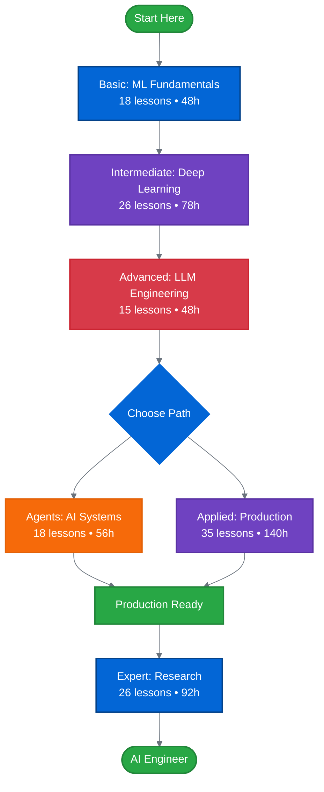

---

## Quick Start

```bash
# Clone the repository
git clone https://github.com/nexageapps/AI.git && cd AI

# Setup virtual environment
python -m venv .venv
source .venv/bin/activate          # Windows: .venv\Scripts\activate

# Install dependencies
pip install -r requirements.txt

# Launch Jupyter
jupyter lab
```

**For live agent lessons:** Set `ANTHROPIC_API_KEY` environment variable. Without it, lessons replay recorded traces.

---

## Learning Paths

### Path Overview

```mermaid
%%{init: {'theme':'base', 'themeVariables': {'primaryColor':'#0366d6','primaryTextColor':'#fff','primaryBorderColor':'#0366d6','lineColor':'#6a737d','secondaryColor':'#0366d6','fontSize':'16px'}}}%%
flowchart LR
    subgraph Path1["Path 1: Complete Journey (579h)"]
        P1A[Basic] --> P1B[Intermediate]
        P1B --> P1C[Advanced]
        P1C --> P1D[Agents]
        P1D --> P1E[Applied]
        P1E --> P1F[Expert]
    end
    
    subgraph Path2["Path 2: Fast Track (110h)"]
        P2A[Advanced<br/>A01-A04] --> P2B[Agents<br/>AG01-AG18]
        P2B --> P2C[Applied<br/>AP01-AP10]
    end
    
    subgraph Path3["Path 3: LLM to Prod (90h)"]
        P3A[Agents<br/>AG02-AG18] --> P3B[Applied<br/>AP01-AP35]
    end
    
    subgraph Path4["Path 4: Research (150h)"]
        P4A[Basic<br/>skim] --> P4B[Intermediate]
        P4B --> P4C[Advanced<br/>A05-A07]
        P4C --> P4D[Expert]
    end
    
    style Path1 fill:#0366d6,stroke:#044289,color:#fff
    style Path2 fill:#6f42c1,stroke:#5a32a3,color:#fff
    style Path3 fill:#d73a49,stroke:#cb2431,color:#fff
    style Path4 fill:#28a745,stroke:#22863a,color:#fff
```

### Detailed Path 1: Complete Beginner (579 hours)

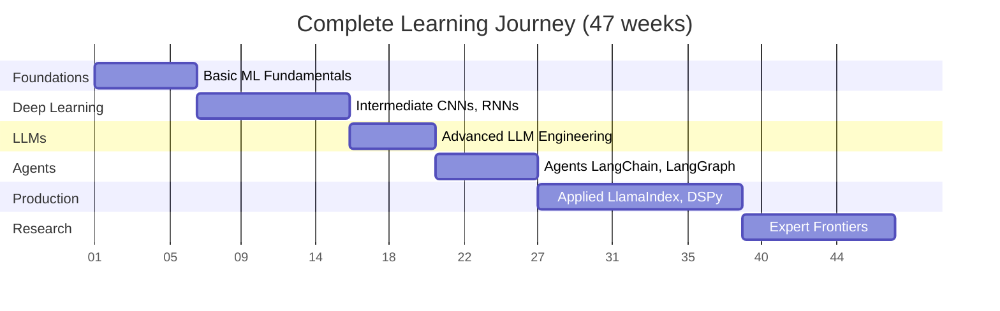

---

## Technology Stack

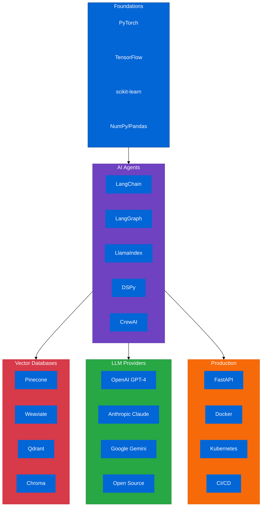

---

## Curriculum Architecture

### System Design View

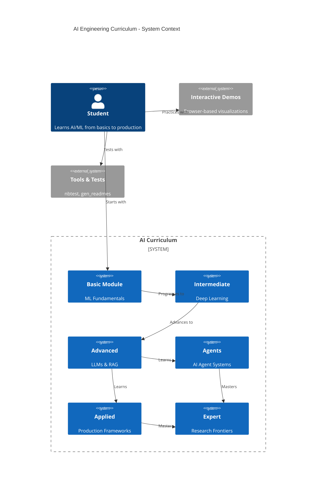

### Module Completion Status

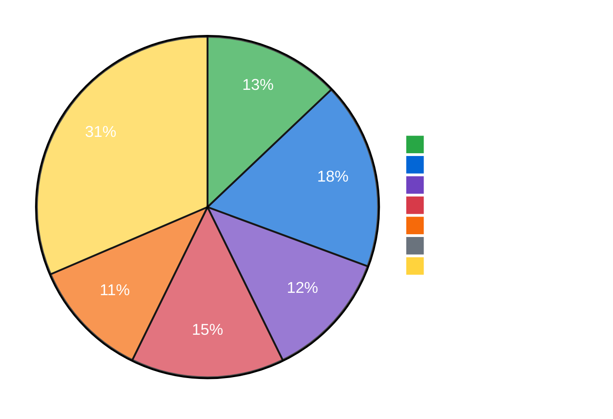

---

## AI Agent Architecture

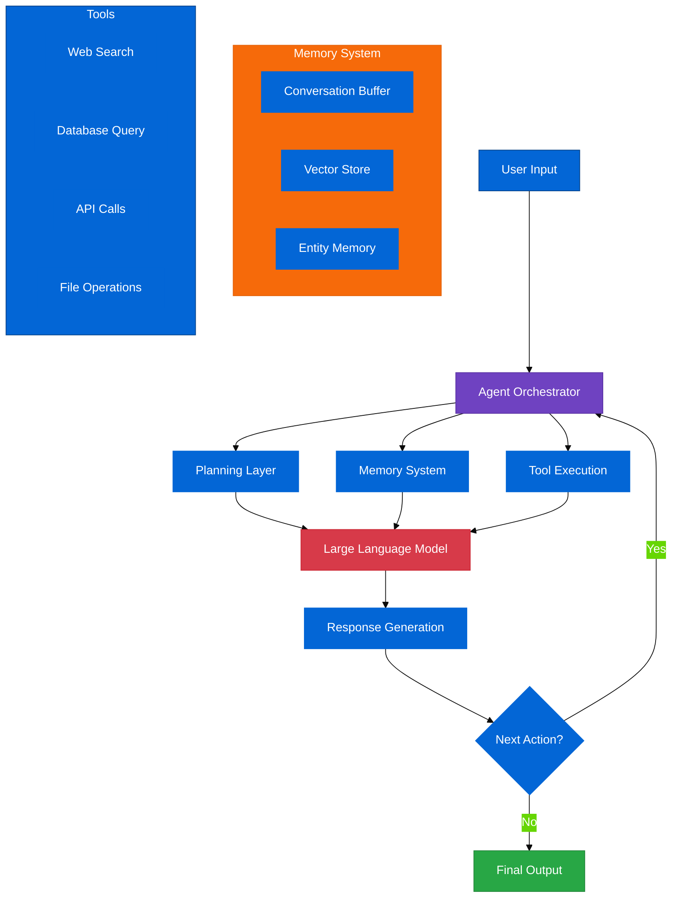

---

## RAG System Architecture

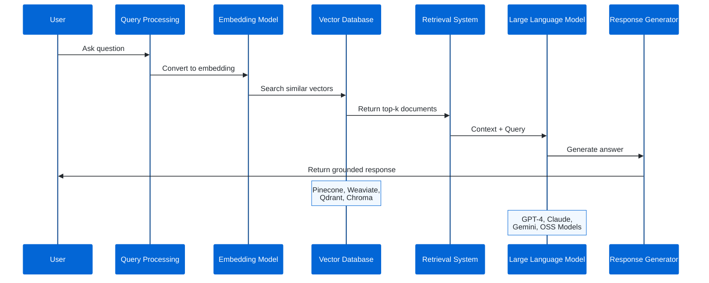

---

## Lesson Flow Architecture

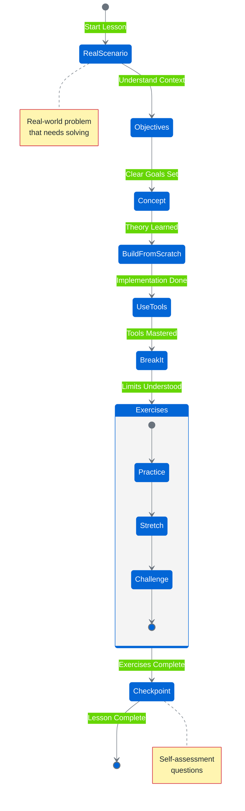

---

## Production Deployment Pipeline

```mermaid
%%{init: {'theme':'base', 'themeVariables': {'primaryColor':'#0366d6','primaryTextColor':'#fff','primaryBorderColor':'#0366d6'}}}%%
graph LR
    subgraph Development
        D1[Code] --> D2[Test Locally]
        D2 --> D3[nbtest.py]
    end
    
    subgraph CICD[CI/CD]
        D3 --> C1[GitHub Actions]
        C1 --> C2[Run Tests]
        C2 --> C3[Build Docker]
    end
    
    subgraph Deployment
        C3 --> P1[Container Registry]
        P1 --> P2[Kubernetes]
        P2 --> P3[Load Balancer]
    end
    
    subgraph Monitoring
        P3 --> M1[Prometheus]
        M1 --> M2[Grafana]
        M2 --> M3[Alerts]
    end
    
    M3 -->|Issues| D1
    
    style Development fill:#0366d6,stroke:#044289,color:#fff
    style CICD fill:#6f42c1,stroke:#5a32a3,color:#fff
    style Deployment fill:#d73a49,stroke:#cb2431,color:#fff
    style Monitoring fill:#28a745,stroke:#22863a,color:#fff
```

---

## Interactive Demonstrations

**Explore AI concepts visually** → [**Launch All Demos**](https://nexageapps.github.io/AI/)

### Demo Categories

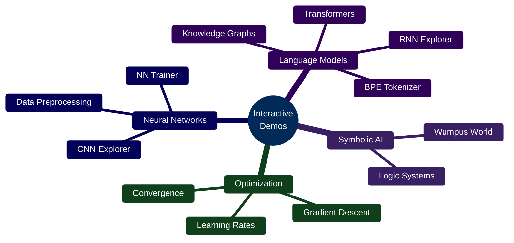

### Featured Demonstrations

<table>
<tr>
<td width="33%" align="center">
<h4>Wumpus World</h4>

<p><strong>Symbolic Logic & Reasoning</strong></p>
<p>Knowledge representation, uncertainty</p>
<p><a href="https://nexageapps.github.io/AI/wumpus">Launch Demo</a></p>
</td>
<td width="33%" align="center">
<h4>Gradient Descent</h4>

<p><strong>Optimization Fundamentals</strong></p>
<p>Learning rates, convergence</p>
<p><a href="https://nexageapps.github.io/AI/gradient-descent">Launch Demo</a></p>
</td>
<td width="33%" align="center">
<h4>CNN Explorer</h4>

<p><strong>Convolutional Networks</strong></p>
<p>Feature maps, pooling, filters</p>
<p><a href="https://nexageapps.github.io/AI/neural-networks/week3/cnn-explorer/">Launch Demo</a></p>
</td>
</tr>
<tr>
<td width="33%" align="center">
<h4>Knowledge Graphs</h4>

<p><strong>Semantic Reasoning</strong></p>
<p>RDF triples, graph queries</p>
<p><a href="https://nexageapps.github.io/AI/ai-fundamentals/week3/kg-playground/">Launch Demo</a></p>
</td>
<td width="33%" align="center">
<h4>Transformer</h4>

<p><strong>Self-Attention</strong></p>
<p>Q/K/V matrices, multi-head attention</p>
<p><a href="https://nexageapps.github.io/AI/neural-networks/week4/transformer-explorer/">Launch Demo</a></p>
</td>
<td width="33%" align="center">
<h4>BPE Tokenization</h4>

<p><strong>Subword Encoding</strong></p>
<p>Byte pair encoding, vocabulary</p>
<p><a href="https://nexageapps.github.io/AI/neural-networks/week4/bpe-explorer/">Launch Demo</a></p>
</td>
</tr>
</table>

[**View All 14+ Demonstrations**](https://nexageapps.github.io/AI/)

---

## Lesson Design Pattern

Every lesson follows this proven structure:

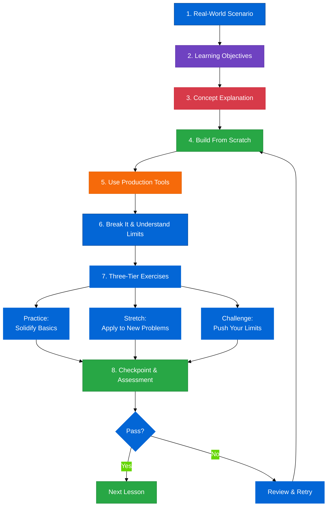

### Core Principles

- **Runs offline, free, no GPU required**
- **Production-ready code examples**
- **Industry-standard tools and frameworks**
- **Hands-on exercises at every step**
- **Progressive difficulty curve**
- **Clear, measurable learning objectives**
- **Self-paced with checkpoints**
- **Open-source and free forever**

---

## Project Structure

```
AI/
│
├── Basic/                           # 18 lessons: ML fundamentals
├── Intermediate/                    # 26 lessons: Deep learning
├── Advanced/                        # 15 lessons: LLMs & RAG
├── Agents/                          # 18 lessons: AI agents
├── Applied/                         # 35 lessons: Production
├── Expert/                          # 26 lessons: Research
├── Electives/                       # 39 lessons: Specialized
│
├── agentkit/                        # Shared library for agents
├── tools/                           # Build, test, curriculum tools
├── application/                     # Interactive demos
├── documentation/                   # All guides
│   ├── diagrams/                    # Excalidraw & Mermaid sources
│   ├── CURRICULUM.md
│   ├── LEARNING_SEQUENCE.md
│   └── QUICK_REFERENCE.md
│
└── README.md                        # This file
```

---

## Module Dependencies

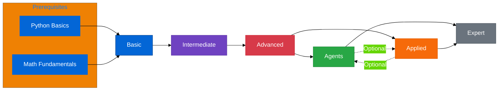

---

## Contributing Workflow

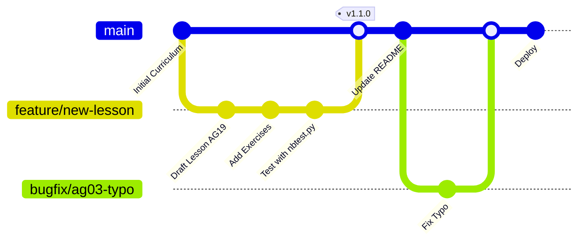

### Contribution Process

1. **Fork** the repository
2. **Create** a feature branch
3. **Write** or improve lessons
4. **Test** with `python tools/nbtest.py`
5. **Submit** a pull request

[**Read Full Contributing Guide**](./CONTRIBUTING.md)

---

## Quality Standards

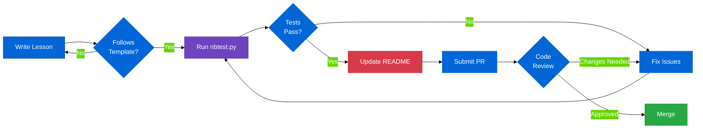

---

## Learning Progress Tracker

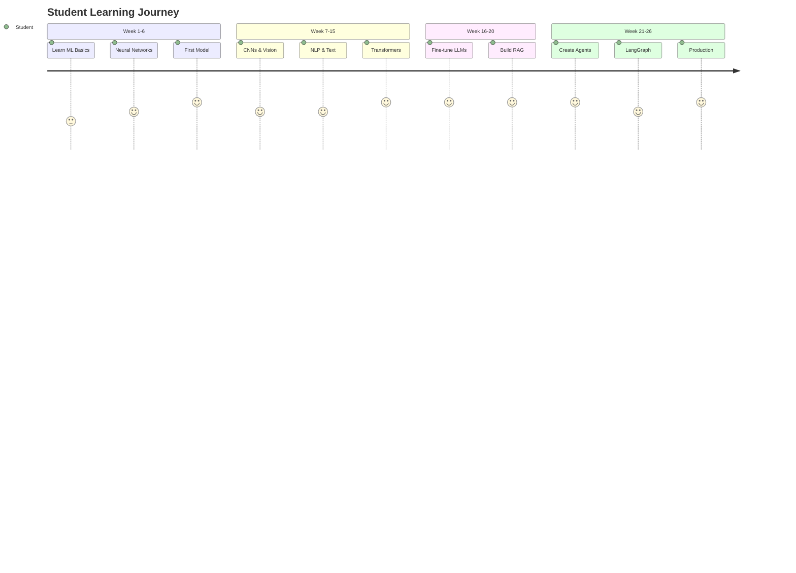

---

## License & Academic Integrity

### MIT License - Free to Use

This repository is **free, open-source educational material** (MIT).

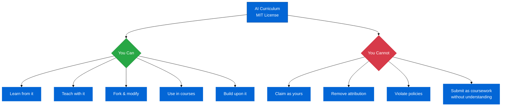

**Full policy:** [ACADEMIC_INTEGRITY.md](./documentation/ACADEMIC_INTEGRITY.md)

---

## Roadmap

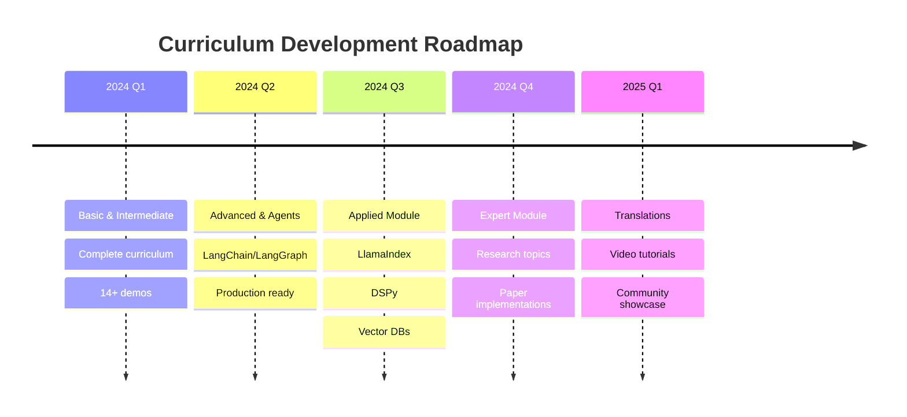

[**View Detailed Roadmap**](./documentation/VIRAL_CURRICULUM_UPDATE_2025.md)

---

## Support This Project

<div align="center">

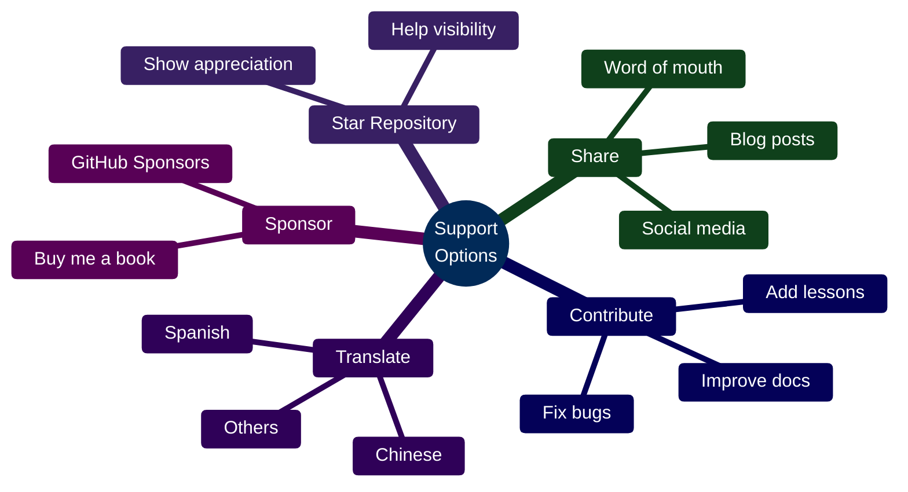

[](https://github.com/nexageapps/AI/stargazers)
[](https://buymeacoffee.com/fcc4sbsx5f6)

**Connect:** [LinkedIn](https://www.linkedin.com/in/karthik-arjun-a5b4a258/) • [Discord](https://discord.com/channels/1482175575488598109/1482175576168206590) • [GitHub](https://github.com/nexageapps/AI)

**Sponsored by** [nexageapps](https://nexageapps.com)

</div>

---

## Target Audience

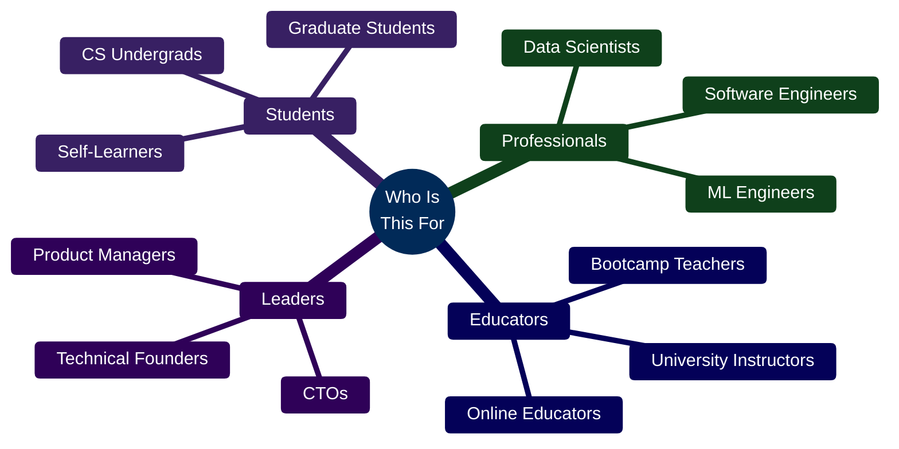

---

<div align="center">

## Ready to Start Your Journey?

**177 lessons • 579 hours • Zero to production AI engineer**

```mermaid
%%{init: {'theme':'base', 'themeVariables': {'primaryColor':'#0366d6','primaryTextColor':'#fff','primaryBorderColor':'#0366d6'}}}%%
graph LR
    A[Read Curriculum] --> B[Try Demos]
    B --> C[Start Learning]
    C --> D[Build Projects]
    D --> E[Master AI Engineering]
    
    style A fill:#0366d6,stroke:#044289,color:#fff
    style B fill:#6f42c1,stroke:#5a32a3,color:#fff
    style C fill:#d73a49,stroke:#cb2431,color:#fff
    style D fill:#f66a0a,stroke:#e36209,color:#fff
    style E fill:#28a745,stroke:#22863a,color:#fff
```

[**Browse Curriculum**](./documentation/CURRICULUM.md) • [**Try Demos**](https://nexageapps.github.io/AI/) • [**Quick Start**](#quick-start)

---

**Made for the AI community** • **Open source forever** • **Production-ready examples**

<sub>Star this repo to support the project and help others discover it</sub>

</div>
