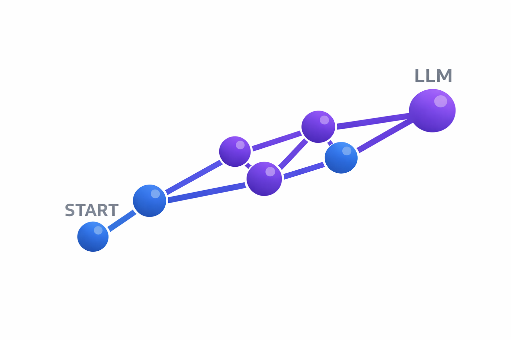
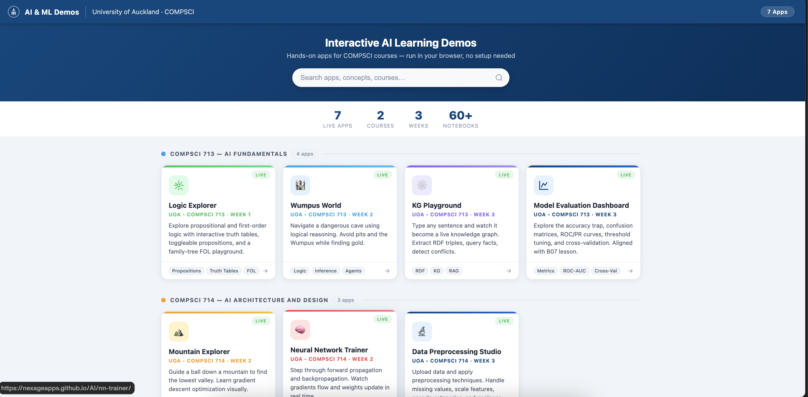

<div align="center">



# AI Engineering: From Foundations to Production Agents

### Master AI, LLMs, Agents & Modern Frameworks

**Open-source AI engineering curriculum for building intelligent systems.**

From ML Fundamentals → LLMs & RAG → AI Agents → Production Deployment. Hands-on lessons with PyTorch, LangChain, LlamaIndex, DSPy, FastAPI & more.

[Curriculum](./documentation/CURRICULUM.md) • [Quick Start](#quick-start) • [Student Guide](./documentation/STUDENT_GUIDE.md) • [Exam Prep](./documentation/EXAM_PREPARATION_GUIDE.md) • [LinkedIn](https://www.linkedin.com/in/karthik-arjun-a5b4a258/) • [Support Project](https://buymeacoffee.com/fcc4sbsx5f6)

[](https://www.python.org/)
[](./LICENSE)
[](./documentation/CURRICULUM.md)
[](#)
[](#)
[](https://nexageapps.com)
[](https://buymeacoffee.com/fcc4sbsx5f6)

</div>

---

## 🌍 Open-source study material

This repository is **free, open-source educational material** (MIT). Use it to teach yourself, run a study group or a course; fork it, translate it, send improvements. See [CONTRIBUTING.md](./CONTRIBUTING.md) and the [Code of Conduct](./CODE_OF_CONDUCT.md). If it helps you, please cite it ([CITATION.cff](./CITATION.cff)) and star the repo.

---

## ⚠️ Important Disclaimer

This is an **independent learning project**, shared openly as educational material. Use responsibly and follow your institution's academic integrity policies. See [Academic Integrity Policy](./documentation/ACADEMIC_INTEGRITY.md) for details.

---

## What Is This?

A **comprehensive AI engineering curriculum** from ML fundamentals to production AI agents and intelligent systems.

**What you'll build:**
- 🤖 **AI Agents** with LangChain, LangGraph, and LlamaIndex
- 🔍 **RAG Systems** with vector databases (Pinecone, Weaviate, Chroma)
- ⚡ **Production APIs** with FastAPI and modern deployment
- 🧠 **LLM Applications** with prompt engineering and DSPy
- 🎯 **Real Projects** - from notebooks to deployed systems

**Learning path:** Basic ML → Deep Learning → LLMs & RAG → AI Agents → Production Systems → Advanced Research

| | |
|---|---|
| **Pattern** | Basic **18** · Intermediate **26** · Advanced **15** · Agents **18** · Applied **35** · Expert **26** · Electives **39** = **177 lessons** (≈ 500+ h) |
| **Every lesson** | real scenario → objectives → concept → build from scratch → use the real tool → **break it** → exercises (Practice/Stretch/Challenge) → checkpoint |
| **Hands-on** | runs **offline, free, no GPU**; agent lessons also run **live against Claude** with one environment variable |
| **Honest** | the table below is generated from the files on disk, so it can never promise lessons that don't exist |

### Status (auto-generated)

<!-- STATUS:START -->
| Tier | Lessons | Hours | ✅ Ready | ♻️ Retained | 🚧 Planned | Folder |
|---|---|---|---|---|---|---|
| **Basic**: Learn from data | 10 | 26.5 | 0 | 10 | 0 | [`Basic/`](./Basic) |
| **Intermediate**: Representations: vision, sequences, language | 10 | 31 | 0 | 7 | 3 | [`Intermediate/`](./Intermediate) |
| **Advanced**: LLM engineering | 10 | 32 | 10 | 0 | 0 | [`Advanced/`](./Advanced) |
| **Agents**: Systems that decide and act | 15 | 47 | 15 | 0 | 0 | [`Agents/`](./Agents) |
| **Applied**: Real briefs, real metrics | 10 | 40 | 7 | 3 | 0 | [`Applied/`](./Applied) |
| **Expert**: Frontier and research | 10 | 37.5 | 0 | 0 | 10 | [`Expert/`](./Expert) |
| **Total** | **65** | **214** | **32** | **20** | **13** | |
<!-- STATUS:END -->

### Tech Stack Covered

```
🎯 Foundations          🤖 AI Agents              🚀 Production
├─ PyTorch              ├─ LangChain              ├─ FastAPI
├─ TensorFlow           ├─ LangGraph              ├─ Docker
├─ scikit-learn         ├─ LlamaIndex             ├─ Kubernetes
├─ NumPy/Pandas         ├─ DSPy                   ├─ CI/CD
└─ Transformers         └─ CrewAI                 └─ Monitoring

🗄️ Vector DBs           💬 LLMs                   📊 Frameworks
├─ Pinecone             ├─ OpenAI                 ├─ Haystack  
├─ Weaviate             ├─ Anthropic Claude       ├─ Semantic Kernel
├─ Qdrant               ├─ Open Source LLMs       └─ Guardrails AI
└─ Chroma               └─ Fine-tuning            
```

### Learning Path

```
Basic (ML/DL)  →  Intermediate (Vision/NLP)  →  Advanced (LLMs)
      ↓                    ↓                           ↓
   Agents (LangChain/LlamaIndex)  ←  Applied (Production)  →  Expert (Research)
```

---

## Quick Start

```bash
git clone https://github.com/nexageapps/AI.git && cd AI
python -m venv .venv && source .venv/bin/activate      # Windows: .venv\Scripts\activate
pip install -r requirements.txt
jupyter lab
```

**Optional, for LIVE agent runs:** `export ANTHROPIC_API_KEY=sk-ant-...` (or put it in a git-ignored `.env`). Without a key, every agent notebook replays a recorded trace so you can still run and break everything for free. **Never commit keys.**

### Naming convention

Lessons are named **`<ID>-<kebab-title>.ipynb`**, e.g. `AG03-tools-done-right.ipynb`: the ID is a tier letter plus two digits (`B` Basic, `I` Intermediate, `A` Advanced, `AG` Agents, `AP` Applied, `E` Expert), the title is lowercase-hyphenated with no spaces. The last lesson in each tier is the capstone. Full rules in [CURRICULUM.md §6](./documentation/CURRICULUM.md#6-naming-conventions); checked by `python tools/check_names.py`.

### Choose your path

| You are… | Do this | Time |
|---|---|---|
| New to ML | Basic → Intermediate → Advanced → Agents | ~215 h |
| Know ML, want to build agents (**fast track**) | A01 → A04, then **AG01 → AG15**, then AP01–AP06 | ~90 h |
| Know LLM APIs already | AG02 → AG15 → Applied | ~75 h |
| Want research | Basic (skim) → Intermediate → Advanced A05–A07 → Expert | ~130 h |

### Recommended weekly rhythm (8 h/week)
Two 3-hour lesson sessions + one 2-hour review/project block. One lesson = one session; the capstone of each tier gets a full week.

---

## Tiers

| Tier | Folder | Lessons |
|---|---|---|
| Basic · Learn from data | [`Basic/`](./Basic) | B01–B10 |
| Intermediate · Vision, sequences, language | [`Intermediate/`](./Intermediate) | I01–I10 |
| Advanced · LLM engineering | [`Advanced/`](./Advanced) | A01–A10 |
| **Agents · Systems that decide and act** | [`Agents/`](./Agents) | AG01–AG15 |
| Applied · Real briefs, real metrics | [`Applied/`](./Applied) | AP01–AP10 |
| Expert · Frontier and research | [`Expert/`](./Expert) | E01–E10 |
| Electives · classical AI, university-course companions, legacy frameworks | [`Electives/`](./Electives) | optional |

```
AI/
├── Basic/ Intermediate/ Advanced/ Agents/ Applied/ Expert/   # the 65-lesson core
├── Electives/            # kept, off-path notebooks (classical AI, AI Fundamentals/714 companions, older frameworks)
├── agentkit/             # tiny library behind every agent lesson (LIVE/OFFLINE model, @tool, tracing, run_agent)
├── tools/                # curriculum.json (source of truth), nbbuild.py, nbtest.py, gen_readmes.py, LESSON_AUTHORING.md
├── application/          # interactive browser demos (source + deploy guides)
├── documentation/        # student guide, exam prep, course guides, integrity & security policies
└── documentation/CURRICULUM.md  documentation/LEARNING_SEQUENCE.md  README.md
```

---

## Live Demos & Practical Applications

Interactive demonstrations of AI concepts in action:

<div align="center">
  <a href="https://nexageapps.github.io/AI/">
    
  </a>
  <p><em>Interactive AI demos — playable in your browser</em></p>
</div>

| Demo | Concept | Course | Course Page | Notebook | Link |
|------|---------|--------|-------------|----------|------|
| **Wumpus World** | Symbolic Logic & Knowledge Representation | AI Fundamentals | [AI Fundamentals](#ai-fundamentals) | — | [Play Online](https://nexageapps.github.io/AI/wumpus) |
| **Mountain Explorer** | Gradient Descent & Optimization | Neural Networks | [Neural Networks](./documentation/courses/NEURAL_NETWORKS_GUIDE.md) | [B02 - Linear Regression](https://github.com/nexageapps/AI/blob/main/Basic/B02-linear-regression-and-gradient-descent.ipynb) · [B05b - Training & Optimization](https://github.com/nexageapps/AI/blob/main/Electives/Course-Companions/B05b-training-and-optimization.ipynb) | [Play Online](https://nexageapps.github.io/AI/gradient-descent) |
| **Blindfold Hill** | Gradient Descent, Learning Rate & Convergence | Neural Networks | [Neural Networks](./documentation/courses/NEURAL_NETWORKS_GUIDE.md) | [B02 - Linear Regression](https://github.com/nexageapps/AI/blob/main/Basic/B02-linear-regression-and-gradient-descent.ipynb) · [B05b - Training & Optimization](https://github.com/nexageapps/AI/blob/main/Electives/Course-Companions/B05b-training-and-optimization.ipynb) | [Play Online](https://nexageapps.github.io/AI/neural-networks/week2/blindfold-hill) |
| **Neural Network Trainer** | Forward Propagation, Backpropagation & Gradient Descent | Neural Networks | [Neural Networks](./documentation/courses/NEURAL_NETWORKS_GUIDE.md) | [B05 - Neural Network Fundamentals](https://github.com/nexageapps/AI/blob/main/Basic/B09-neural-networks-from-scratch.ipynb) · [B05a - Neural Networks Theory](https://github.com/nexageapps/AI/blob/main/Electives/Course-Companions/B05a-neural-networks-theory.ipynb) | [Play Online](https://nexageapps.github.io/AI/nn-trainer/) |
| **Data Preprocessing Studio** | Missing Values, Feature Scaling, Encoding & Feature Engineering | Neural Networks | [Neural Networks](./documentation/courses/NEURAL_NETWORKS_GUIDE.md) | [B06 - Data Preprocessing and Feature Engineering](https://github.com/nexageapps/AI/blob/main/Basic/B05-data-preprocessing-and-feature-engineering.ipynb) | [Play Online](https://nexageapps.github.io/AI/neural-networks/week3/data-preprocessing-studio) |
| **PyTorch Assignment Practice** | Tabular MLP, BCEWithLogitsLoss, Optuna, FashionMNIST CNN, Saliency Maps | Neural Networks | [Neural Networks](./documentation/courses/NEURAL_NETWORKS_GUIDE.md) | [B05c - MLP on Tabular Data with PyTorch](https://github.com/nexageapps/AI/blob/main/Electives/Course-Companions/B05c-mlp-on-tabular-data-with-pytorch.ipynb) | — |
| **Model Evaluation Dashboard** | Confusion Matrix, ROC/AUC, Precision-Recall & Cross-Validation | AI Fundamentals | [AI Fundamentals](#ai-fundamentals) | [B07 - Model Evaluation](https://github.com/nexageapps/AI/blob/main/Basic/B06-model-evaluation-and-metrics.ipynb) | — |
| **KG Playground** | RDF Triples, Knowledge Graphs, RAG & Conflict Detection | AI Fundamentals | [AI Fundamentals](#ai-fundamentals) | [A03 - Retrieval-Augmented Generation](https://github.com/nexageapps/AI/blob/main/Advanced/A03%20-%20Retrieval-Augmented%20Generation%20(RAG).ipynb) | [Play Online](https://nexageapps.github.io/AI/ai-fundamentals/week3/kg-playground/) |
| **RNN Explorer** | RNN/LSTM/GRU Architecture, Gates & Sequence Modelling | AI Fundamentals | [AI Fundamentals](#ai-fundamentals) | [B10 - RNNs](https://github.com/nexageapps/AI/blob/main/Intermediate/I03-recurrent-neural-networks.ipynb) · [B10a - RNNs (714)](https://github.com/nexageapps/AI/blob/main/Electives/Course-Companions/B10a-recurrent-neural-networks.ipynb) | [Play Online](https://nexageapps.github.io/AI/ai-fundamentals/week4/rnn-explorer/) |
| **CNN Explorer** | Convolution, Pooling, Feature Maps, Architecture & Playground | Neural Networks | [Neural Networks](./documentation/courses/NEURAL_NETWORKS_GUIDE.md) | [B09 - CNNs](https://github.com/nexageapps/AI/blob/main/Intermediate/I01-convolutional-neural-networks.ipynb) | [Play Online](https://nexageapps.github.io/AI/neural-networks/week3/cnn-explorer/) |
| **NEAT Explainer** | NeuroEvolution, Topology Mutation, Speciation & Crossover | AI Fundamentals | [AI Fundamentals](#ai-fundamentals) | — | — |
| **Transformer Explorer** | Self-Attention, Multi-Head Attention, Q/K/V & Architecture | Neural Networks | [Neural Networks](./documentation/courses/NEURAL_NETWORKS_GUIDE.md) | [B11 - Attention & Transformers](https://github.com/nexageapps/AI/blob/main/Intermediate/I04-attention-and-transformers.ipynb) | [Play Online](https://nexageapps.github.io/AI/neural-networks/week4/transformer-explorer/) |
| **BPE Explorer** | Byte Pair Encoding, Tokenization, Subwords & Vocabulary | Neural Networks | [Neural Networks](./documentation/courses/NEURAL_NETWORKS_GUIDE.md) | [B12 - BPE](https://github.com/nexageapps/AI/blob/main/Intermediate/I05-tokenization-and-byte-pair-encoding.ipynb) | [Play Online](https://nexageapps.github.io/AI/neural-networks/week4/bpe-explorer/) |
| **Q-Learning Grid World** | Reinforcement Learning, Q-Tables, Exploration vs Exploitation | AI Fundamentals | [AI Fundamentals](#ai-fundamentals) | — | — |

**[View All Games](https://nexageapps.github.io/AI/)** • Explore the `application/` folder for source code and deployment guides.

---

---

## For University Students

### University Course Companions

| Course | Focus | Examples |
|--------|-------|----------|
| **AI Fundamentals** | AI Fundamentals | [Symbolic Logic, Knowledge Representation, Search, RL, Neuroevolution, Sustainability](./documentation/courses/AI_FUNDAMENTALS_GUIDE.md) |
| **Neural Networks** | Neural Networks | [Networks, Gradient Descent, CNNs, Attention](./documentation/courses/NEURAL_NETWORKS_GUIDE.md) |
| **NLP** | Natural Language Processing | [Semantic Representation, LLMs, RAG, Question Answering, Knowledge Graphs](./documentation/courses/NLP_GUIDE.md) |
| **ML Foundations** | ML Foundations | Regression, Classification, Tuning |
| **Generalising AI** | Generalising AI | Transfer Learning, Domain Adaptation |
| **Deep Learning** | Deep Learning | Detection, Time Series, NLP, GANs |

**[AI Fundamentals Complete Guide](./documentation/courses/AI_FUNDAMENTALS_GUIDE.md)** · **[Neural Networks Complete Guide](./documentation/courses/NEURAL_NETWORKS_GUIDE.md)** · **[NLP Complete Guide](./documentation/courses/NLP_GUIDE.md)**

### Study Tips

- **Before lectures:** Review relevant Basic lessons
- **During semester:** Build practical projects from examples
- **For assignments:** Use as reference, implement your own
- **For exams:** Review all concepts in relevant lessons

**[Complete Student Guide](./documentation/STUDENT_GUIDE.md)**

---

---

## Contributing & Quality bar

A lesson is **ready** only if it follows the template and `python tools/nbtest.py "<path>"` passes offline. See [tools/LESSON_AUTHORING.md](./tools/LESSON_AUTHORING.md). After adding or changing lessons run `python tools/gen_readmes.py` to refresh the status tables. See also [CONTRIBUTING](./documentation/CONTRIBUTING.md) and [SECURITY](./documentation/SECURITY.md).

---

## Academic Integrity

**Appropriate Use:**
- Learning concepts and understanding implementations
- Preparing for lectures and exams
- Using as inspiration for original projects
- Understanding different approaches

❌ **Inappropriate Use:**
- Copying code for assignments without understanding
- Submitting repository code as your own work
- Using during closed-book assessments
- Violating your institution's policies

**[Full Academic Integrity Policy](./documentation/ACADEMIC_INTEGRITY.md)**

---

---

## Support & Author

Open-source AI education built for learners worldwide. Independent educational project.
[LinkedIn](https://www.linkedin.com/in/karthik-arjun-a5b4a258/) · [Discord](https://discord.com/channels/1482175575488598109/1482175576168206590) · [Buy me a book](https://buymeacoffee.com/fcc4sbsx5f6)

MIT License: see [LICENSE](./LICENSE).
