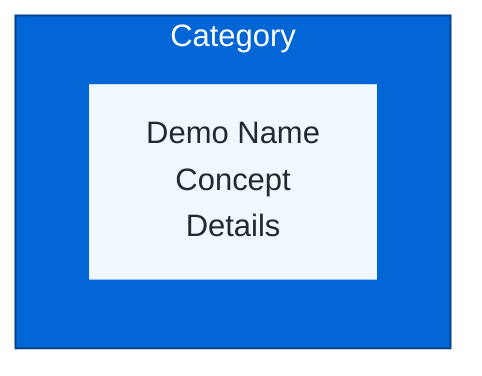

# Demo Section Visual Enhancement Complete

**Date:** October 21, 2026  
**Status:** Enhanced with Mermaid diagram and clean table layout

---

## What Was Changed

### Before: Photo Grid Layout

- Used HTML table with placeholder images
- 3x2 grid of demo cards
- Each card had image, title, description
- Took up significant vertical space
- Images were just placeholders

### After: Mermaid Diagram + Compact Table

1. **Mermaid Category Diagram**
   - Visual organization by concept type
   - 4 main categories with color coding
   - Shows all 10 demos in hierarchical view
   - GitHub dark mode compatible

2. **Comprehensive Table**
   - All demos in one clean table
   - Icons for visual interest
   - Clear columns: Demo | Concept | Learning | Launch
   - Compact and scannable
   - Easy to update

---

## New Visual Structure

```
Demos Section
├── Category Diagram (Mermaid)
│   ├── � Symbolic AI (1 demo)
│   ├── 📈 Optimization (2 demos)
│   ├── 🧠 Neural Networks (3 demos)
│   └── 💬 Language Models (4 demos)
│
└── Demo Table
    └── 10 rows with launch links
```

---

## Mermaid Diagram Features



### Color Scheme
- **Symbolic AI:** Blue (`#0366d6`)
- **Optimization:** Purple (`#6f42c1`)
- **Neural Networks:** Red (`#d73a49`)
- **Language Models:** Green (`#28a745`)

### Dark Mode Support
- Category boxes: Colored with white text
- Demo boxes: Light blu- Demo boxes: Light brks in both light and dark GitHub themes

---

## Table Features

| Feature | Benefit |
|---------|---------|
| **Icons** | Visual categorization (ğŸ�¯ğŸ“ˆğŸ§ ğŸ’¬ğŸ”„🔲🔧🔗ğŸ”�🔀✂ï¸�) | **Icons** | Visual categorizatopic | **Icons** | Visual categorization (ğŸ� Detailed outcomes |
| **Launch Links** | One-click access |
| **Compact** | All demos visibl| **Compact** | All demos visibl| **Compact**Wumpus| **Compact** | All Logic
2. **📈 Mountain Explorer** - Gra2.ent Descent
3. **🔄 Blindfold Hill** - Learnin3. **ğŸ4. **🧠 NN Trainer** -3. **🔄 Blindfold Hill** CNN Explorer** - Convolu3.on
6. **ğŸ”6. **ğŸ”6. **ğŸ”6. **ğŸ”6. **ğŸ”6. **ğŸ”6. **ğŸ”6. **ğŸ”* 6. **ğŸ”6. **ğŸ”6. **ğŸ”6. **ğŸ”6. **ğŸ”6. **ğŸ”6. **ğŸ”9. **🔀 Transformer** 6. **ğŸ”6. **ğŸ”6. **ğŸ”6. **ğŸ”6.rer** - Tokenization

---

## Benefits

### Visual Appeal
- ✓ Mermaid diagram shows organization
- ✓ Color-coded categories
- ✓ Icons add visual interest
- ✓ Professional layout

### Usability
- ✓ All demos visible without scrolling
- ✓ Quick scan for specific topics
- ✓ Clear learning outcomes
- ✓ One-click launch

### Maintenance
- ✓ Easy to add new demos
- ✓ Simple table structure
- ✓ No image dependencies
- ✓ GitHub markdown native

### Accessibility
- ✓ Works in dark mode
- ✓ Screen reader friendly
- ✓ Clear hierarchy
- ✓ Semantic HTML

---

## COMPSCI References

### Status: Found in Built Files

**Location:** Minified JavaScript and HTML in `build/` directories

**Affected Apps:**
1. CNN Explorer
2. Knowledge Graph Playground
3. Symbolic Logic Explorer
4. Neural Network Explorer
5. RNN Explorer
6. Data Preprocessing Studio
7. Transformer Explorer
8. BPE Explorer

**Solution:** Rebuild from source (see `application/CLEANUP_NEEDED.md`)

**Priority:** Medium (not visible in main README, only in live apps)

---

## Files Modified

1. **README.md**
   - Replaced photo grid with Mermaid diagram
   - Added comprehensive demo table
   - Improved section layout

2. **application/CLEANUP_NEEDED.md** (created)
   - Documents COMPSCI references
   - Provides rebuild instructions
   - Lists all affected apps

3. **documentation/DEMO_VISUAL_ENHANCEMENT.md** (this file)
   - Documents the changes
   - Explains new structure

---

## Next Steps

### Immediate (README)
✓ Visual enhancement complete
✓ Demo section improved
✓ Dark mode compatible

### Follow-up (Applications)
- [ ] Rebuild apps from source
- [ ] Remove COMPSCI from app headers
- [ ] Update app titles and meta tags
- [ ] Test and redeploy

### Future Enhancements
- [ ] Add actual screenshots
- [ ] Create demo preview GIFs
- [ ] Add "Try it Now" badges
- [ ] Create demo showcase page

---

## Maintenance

To add a new demo:

1. Add to Mermaid diagram:
   ```
   Demo["Demo Name<br/>Concep   Demo["Demo Name<br/>Concep   Demo["Demo Name<br/>Concep   Demo[" Demo** | Concept | Learning outcomes | [â–¶ Play](link) |
   ```

3. Update count in header:
   ```markdown
   [**View All X+ Demonstrations →**](link)
   ```

---

**Enhancement Complete!** Demo section now more visual and organized.
