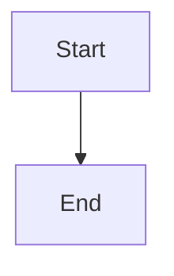

# Diagram Assets

This directory contains source files for visual diagrams used throughout the curriculum.

## Directory Structure

```
diagrams/
├── excalidraw/          # Excalidraw source files (.excalidraw)
├── mermaid/             # Mermaid diagram sources (.mmd)
├── exports/             # Exported images (PNG, SVG)
└── README.md            # This file
```

## Diagram Types

### Mermaid Diagrams (GitHub Native)
Mermaid diagrams render directly on GitHub. Source code is embedded in markdown files.

**Used for:**
- Flowcharts
- Sequence diagrams
- Gantt charts
- State diagrams
- Entity relationship diagrams
- Git graphs
- User journeys
- Mindmaps
- Timelines
- Pie charts

**Files:** See main README.md and documentation files

### Excalidraw Diagrams (Complex Visuals)
Excalidraw creates hand-drawn style diagrams. Best for complex architectures.

**Used for:**
- System architecture
- Infrastructure diagrams
- Complex workflows
- Technical illustrations

**Files in:** `excalidraw/`

## Creating Diagrams

### Mermaid
Edit directly in markdown files:

````markdown

````

Preview: https://mermaid.live/

### Excalidraw
1. Go to https://excalidraw.com/
2. Create your diagram
3. Export as `.excalidraw` and `.png`
4. Save both in appropriate folders

## Current Diagrams

### Main README.md
- Learning Journey (Mermaid graph)
- Learning Paths (Mermaid flowchart)
- Timeline (Mermaid gantt)
- Tech Stack (Mermaid graph)
- Module Status (Mermaid pie)
- AI Agent Architecture (Mermaid graph)
- RAG System (Mermaid sequence)
- Lesson Flow (Mermaid state)
- Deployment Pipeline (Mermaid graph)
- Demo Categories (Mermaid mindmap)
- Module Dependencies (Mermaid graph)
- Contributing Workflow (Mermaid git)
- Quality Standards (Mermaid flowchart)
- Learning Progress (Mermaid journey)
- License Options (Mermaid graph)
- Roadmap (Mermaid timeline)
- Support Options (Mermaid mindmap)
- Target Audience (Mermaid mindmap)

### Excalidraw Diagrams (To Create)
- [ ] Detailed system architecture
- [ ] Infrastructure setup
- [ ] Data flow diagrams
- [ ] Agent interaction patterns
- [ ] Vector database comparisons

## Exporting Diagrams

### From Mermaid
```bash
# Using Mermaid CLI
npm install -g @mermaid-js/mermaid-cli
mmdc -i diagram.mmd -o diagram.png
```

### From Excalidraw
1. File → Export image
2. Choose PNG or SVG
3. Save to `exports/`

## Guidelines

### Style Consistency
- Use similar color schemes
- Maintain consistent typography
- Follow architectural diagram standards
- Keep diagrams simple and clear

### Colors
- Blue (#e3f2fd): Basic/Foundation
- Orange (#fff3e0): Agents
- Purple (#f3e5f5): Advanced/LLMs
- Green (#e8f5e9): Production/Applied
- Pink (#fce4ec): Tools/Support

### Naming Convention
```
<type>-<name>-<variant>.ext

Examples:
- mermaid-learning-path-complete.mmd
- excalidraw-system-architecture.excalidraw
- export-learning-path-complete.png
```

## Contributing Diagrams

When adding new diagrams:

1. Create the diagram
2. Export in multiple formats
3. Update this README
4. Reference in relevant docs
5. Submit PR with all files

## Tools

### Recommended
- [Mermaid Live Editor](https://mermaid.live/)
- [Excalidraw](https://excalidraw.com/)
- [Draw.io](https://app.diagrams.net/) (alternative)

### Mermaid Themes
```javascript
%%{init: {'theme':'base', 'themeVariables': {
  'primaryColor':'#e3f2fd',
  'primaryTextColor':'#1a237e',
  'primaryBorderColor':'#1976d2',
  'lineColor':'#42a5f5',
  'secondaryColor':'#fff3e0',
  'tertiaryColor':'#f3e5f5'
}}}%%
```

## License

All diagrams are released under MIT License, same as the repository.

---

**Need help?** Open an issue or ask in Discord.
